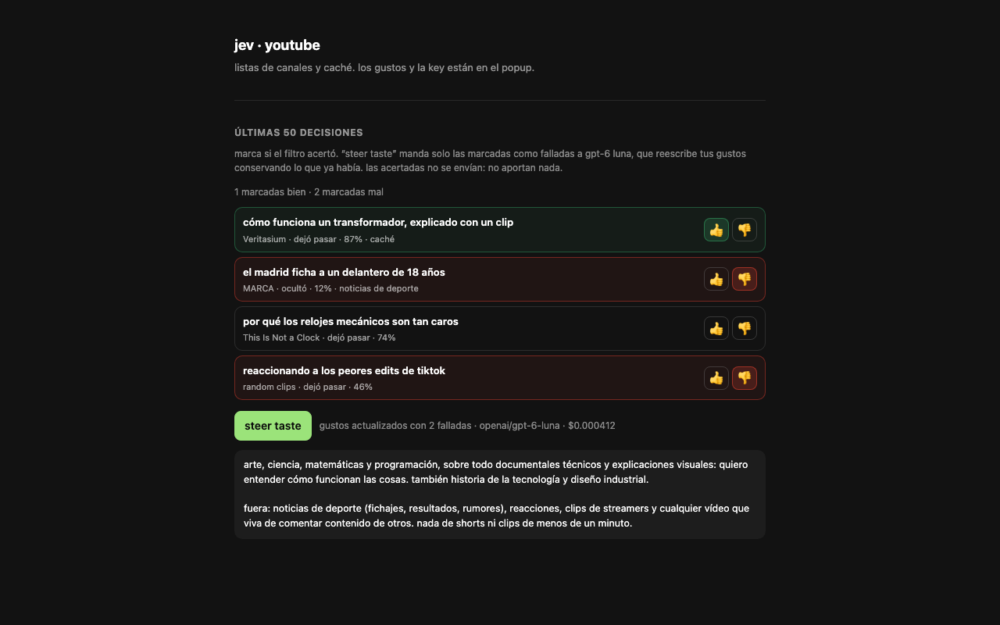
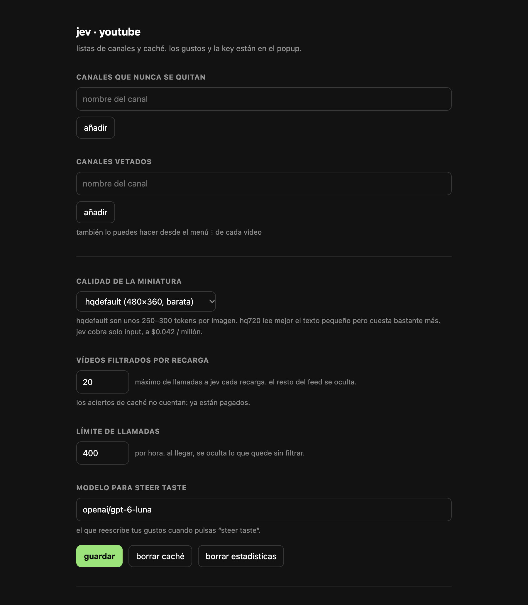

# jev · youtube

A Chrome/Safari extension that sends the title and thumbnail of every video in your
YouTube home feed to [jev](https://openrouter.ai/typesafe/jev-1.14) and decides
whether it's worth your time. What isn't, disappears from the feed.


> The extension UI is in Spanish. The code, comments and docs are in English.

## what it does

- **only works on the home feed** (`youtube.com/`). In search, on a watch page or
  anywhere else it does nothing: it neither decides nor hides cards.
- reads every feed card (title, channel, whether it's a short) and sends it to jev
  together with the thumbnail, which is where the text that gives it away usually is.
- **long videos only**: shorts, live streams, premieres, members-only videos, posts,
  playlists, mixes and channels are hidden without calling jev.
- **per-load cap**: at most `maxPerLoad` jev calls (20 by default). Whatever hasn't
  been filtered gets hidden, so nothing slips through unfiltered. Cache hits don't
  count towards the cap.
- hides anything scoring below the threshold. The threshold is yours.
- removes shorts, thumbnails and channel avatars, each one separately. Thumbnails and
  avatars are removed across YouTube; shorts too.
- while watching a video, it removes the recommendations column (`#related`).
- **on-disk cache**: each video is asked about once. If you change your taste or the
  threshold, the cache is dropped and everything is decided again.
- allow list and block list, editable from the `⋮` menu on each video or from the
  settings page. In the menu, *remove this channel for good* adds it to the block
  list.
- hourly call limit, so a long scroll session can't burn through your credits.
- **decision history**: settings keep the last 50 decisions with title, channel,
  threshold and reason. You can mark each one as right or wrong.

## steer taste

Mark the decisions the filter got wrong (right ones aren't sent, they're noise) and
press *steer taste*. Your current taste text plus those decisions go to
`openai/gpt-6-luna`, which rewrites your taste keeping what was already there and
adding the nuance. The list goes in two groups, because the meaning depends on what
the filter did:

| decision | what it means |
| --- | --- |
| hidden, marked wrong | you wanted it |
| let through, marked wrong | you didn't |

It's stored in `storage.local`, so it survives reloading the extension. The model is
configurable from the settings page.



## cost

- `typesafe/jev-1.14`: **$0.042 per million input tokens**, output is free.
- the `hqdefault` thumbnail is 480×360 → ~250 tokens, ~20 KB. It's the **smallest jev
  accepts** (it needs at least 256 px per side, so `mqdefault` at 320×180 works, but
  `default` at 120×90 gets a 400).
- a typical video costs **~$0.00004**. A thousand videos, four cents.

## install

You need an [OpenRouter API key](https://openrouter.ai/keys) with some credit on it.

1. `chrome://extensions` → enable *Developer mode* → *Load unpacked* → pick this
   folder.
2. Open the icon, paste your API key and write down your taste.
3. Hit *test jev* to check it answers before trusting it.

Same process on Edge and Brave (`edge://extensions`, `brave://extensions`).

### on Safari

macOS 26+ / Safari 26+ has the same as Chrome: **Settings → Developer → Add temporary
extension**. Pick this folder and you're done, no Apple account needed.

The catch is that the temporary extension **is removed every time you quit Safari**.
If you're going to use it daily, sign it with a free Apple ID *personal team*
(`xcrun safari-web-extension-packager`) and it lasts a year. That needs Xcode
installed.

## settings



`⋮` on each video → block channels on the spot. The full settings page (`decisiones,
canales y caché` in the popup) adds:

- allow list and block list
- thumbnail quality (`hqdefault` cheap, `hq720` sharper and pricier)
- per-load video cap and hourly call limit
- model for *steer taste*
- clear cache and stats
- decision history with right/wrong marks and the *steer taste* button

## privacy

- the API key **is only stored in your browser's `storage.local`** and is only sent
  to `openrouter.ai` in the `Authorization` header. No own server, no telemetry.
- the only thing leaving your machine is what's needed to decide: **title, channel
  and thumbnail** of the video, plus your taste text. All of it goes to OpenRouter,
  which forwards it to the model. Decision history and channel lists never leave.
- the extension **doesn't read** your YouTube history, account or cookies: only the
  DOM of the page you already have open.

## structure

```
manifest.json
src/background.js   the queue, the cache and the jev call
src/content.js      reads cards, hides them, adds items to the ⋮ menu
src/content.css     all hiding lives here, so it can be undone
src/popup.html      API key + taste + threshold
src/options.html    channel lists, cache, decisions and steer taste
icons/              16/32/48/128 icons
```

No build step, no dependencies: edit, reload the extension, done.

## limitations

- if YouTube changes the feed DOM (it happens often), card parsing can break. It's
  usually a matter of adjusting the selectors in `src/content.js`.
- the filter depends on how you describe your taste. Leave it empty and it decides
  with a generic rule ("useful things before noise") and won't know you.
- it's not a tool to *stop watching YouTube*: it's to make the feed you already see
  worth it. It doesn't block the site or track time.

## disclaimer

Personal project, not affiliated with YouTube, Google, Apple or OpenRouter. Use it
with your own account and API quota. Video content belongs to its authors.

## license

[MIT](LICENSE) © 2026 Luca
