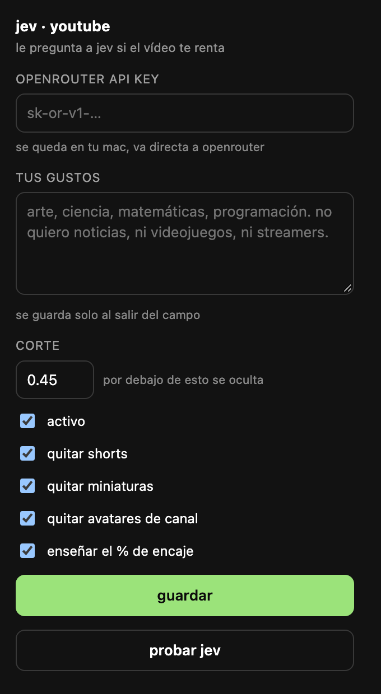

# jev · youtube

Extensión de Chrome/Safari que le pasa el título y la miniatura de cada vídeo de tu
feed a [jev](https://openrouter.ai/typesafe/jev-1.14) y decide si te renta verlo. Lo
que no, desaparece del feed.




## qué hace

- **solo actúa en el feed de inicio** (`youtube.com/`). en búsqueda, dentro de un
  vídeo o en cualquier otra página no filtra: no decide ni oculta tarjetas.
- lee cada tarjeta del feed (título, canal, si es short) y la manda a jev junto con
  la miniatura, que es donde suele estar el texto que lo dice todo.
- **solo vídeos largos**: shorts, directos, estrenos, vídeos solo para miembros,
  posts, playlists, mixes y canales se ocultan sin llamar a jev.
- **tope por recarga**: como mucho `maxPerLoad` llamadas a jev (20 por defecto). lo
  que no se haya filtrado se oculta: no queda nada sin pasar por el filtro. los
  aciertos de caché no cuentan para el tope.
- oculta lo que puntúa por debajo del corte. el corte lo pones tú.
- quita shorts, miniaturas y avatares de canal, por separado. miniaturas y avatares
  se quitan en todo youtube; los shorts también.
- al ver un vídeo, quita la columna de recomendados (`#related`).
- **caché en disco**: cada vídeo se pregunta una sola vez. si cambias tus gustos o
  el corte, la caché se tira y se vuelve a decidir.
- lista de canales que nunca se quitan y lista de vetados, editables desde el menú
  `⋮` de cada vídeo o desde los ajustes. en el menú, *quitar este canal para
  siempre* lo añade a los vetados.
- tope de llamadas por hora, para que no se te vaya la mano si scrolleas mucho.
- **historial de decisiones**: los ajustes guardan las últimas 50 decisiones con
  título, canal, corte y motivo. puedes marcar cada una como acertada o fallada.

## por qué jev y no un chat normal

jev es un modelo de decisión de Typesafe. no escribe texto: le mandas un `state` y
una pregunta tipada, y te devuelve un número con probabilidades. eso es justo lo que
queremos (un score de 0 a 1, sin parsear prosa) y sale mucho más barato, porque los
tokens de salida son gratis.

**el endpoint** no es `/api/v1/chat/completions`. es:

```
POST https://openrouter.ai/api/alpha/decisions
```

```json
{
  "model": "typesafe/jev-1.14",
  "state": [
    "titulo: ...\ncanal: ...",
    { "type": "image_url", "image_url": { "url": "data:image/jpeg;base64,..." } }
  ],
  "questions": {
    "encaje": { "type": "score", "instructions": "...", "criteria": ["...", "...", "...", "..."] },
    "short":  { "type": "noul", "instructions": "es un short vertical" }
  }
}
```

devuelve:

```json
{
  "answers": {
    "encaje": { "type": "score", "score": 2.6, "confidence": 0.71, "probabilities": {} },
    "short":  { "type": "noul", "noul": 0.03 }
  },
  "usage": { "input_tokens": 812, "cost": 0.0000341 }
}
```

el `score` viene en la escala de los niveles (0..3 con cuatro niveles), así que aquí
se normaliza a 0..1 dividiendo por 3.

## steer taste

Con las decisiones marcadas como falladas (las acertadas no se envían, son ruido), un
botón manda el texto de gustos actual más esa lista a `openai/gpt-6-luna`, que
reescribe tus gustos conservando lo que ya había y añadiendo los matices. La lista va
en dos grupos, porque el sentido depende de qué hizo el filtro:

| decisión | lo que significa |
| --- | --- |
| ocultado y marcado como fallo | lo querías |
| dejado pasar y marcado como fallo | te sobraba |

Se guarda en `storage.local`, así que sobrevive a recargar la extensión. El modelo es
configurable desde los ajustes.

## el coste

- `typesafe/jev-1.14`: **$0.042 por millón de tokens de entrada**, salida gratis.
- la miniatura `hqdefault` es 480×360 → ~250 tokens, ~20 KB. es la **más pequeña que
  jev acepta** (pide mínimo 256 px por lado, así que `mqdefault` de 320×180 vale,
  pero `default` de 120×90 la rechazan con un 400).
- un vídeo típico sale por **~$0.00004**. mil vídeos, cuatro céntimos.

## montarlo

Necesitas una API key de [OpenRouter](https://openrouter.ai/keys) con algo de saldo.

1. `chrome://extensions` → activa *modo de desarrollador* → *cargar descomprimida* →
   elige esta carpeta.
2. abre el icono, pega tu API key y escribe tus gustos.
3. dale a *probar jev* para ver que responde antes de fiarte.

En Edge y Brave es el mismo proceso (`edge://extensions`, `brave://extensions`).

### en safari

macOS 26+ / Safari 26+ tiene lo mismo que Chrome: **ajustes → developer → añadir
extensión temporal**. eliges esta carpeta y ya está, sin cuenta de Apple.

el problema es que la extensión temporal **se descarga cada vez que cierras Safari**.
si lo vas a usar a diario, lo suyo es firmarla con un *personal team* de Apple ID
gratis (`xcrun safari-web-extension-packager`), y así aguanta un año. eso sí, pide
tener Xcode instalado.

## ajustes


`⋮` de cada vídeo → canales vetados al momento. La página de ajustes completa
(`decisiones, canales y caché` en el popup) añade:

- canales que nunca se quitan y canales vetados
- calidad de la miniatura (`hqdefault` barata, `hq720` más nítida y más cara)
- tope de vídeos filtrados por recarga y límite de llamadas por hora
- modelo para *steer taste*
- borrar caché y estadísticas
- historial de decisiones con acertada/fallada y el botón de *steer taste*

## privacidad

- la API key **solo se guarda en `storage.local` de tu navegador** y solo se envía a
  `openrouter.ai` en la cabecera `Authorization`. no hay servidor propio ni telemetría.
- lo único que sale de tu máquina es lo que hace falta para decidir: **título, canal
  y miniatura** del vídeo, más el texto de tus gustos. todo va a OpenRouter, que lo
  pasa al modelo. el historial de decisiones y las listas de canales no salen nunca.
- la extensión **no lee** tu historial de YouTube, tu cuenta ni tus cookies: solo el
  DOM de la página que ya tienes abierta.

## estructura

```
manifest.json
src/background.js   la cola, la caché y la llamada a jev
src/content.js      lee las tarjetas, oculta, y añade cosas al menú ⋮
src/content.css     todo el ocultar va por aquí, para poder deshacerlo
src/popup.html      API key + gustos + corte
src/options.html    listas de canales, caché, decisiones y steer taste
icons/              iconos 16/32/48/128
```

No hay build ni dependencias: editas, recargas la extensión y ya.

## limitaciones

- si YouTube cambia el DOM del feed (pasa a menudo), la lectura de tarjetas puede
  romperse. suele ser cuestión de ajustar los selectores de `src/content.js`.
- el filtro depende de cómo describas tus gustos. con el campo vacío decide con un
  criterio genérico ("cosas útiles antes que ruido") y no te va a conocer.
- no es una herramienta para *no ver YouTube*: es para que el feed que ya ves merezca
  la pena. no bloquea la web ni cuenta tiempo.

## aviso

Proyecto personal, sin relación con YouTube, Google, Apple ni OpenRouter. Úsalo bajo
tu cuenta y tu cuota de API. El contenido de los vídeos es de sus autores.

## licencia

[MIT](LICENSE) © 2026 Luca
